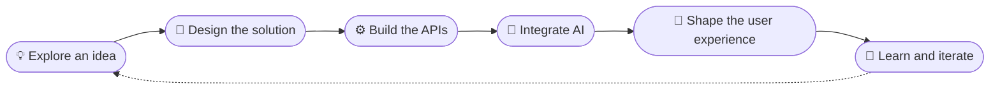
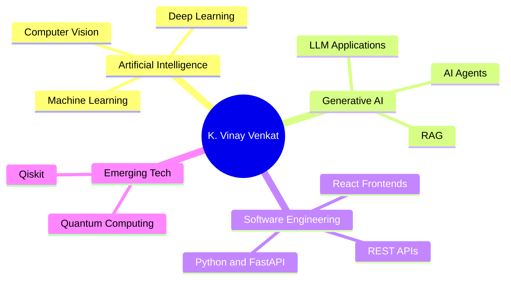
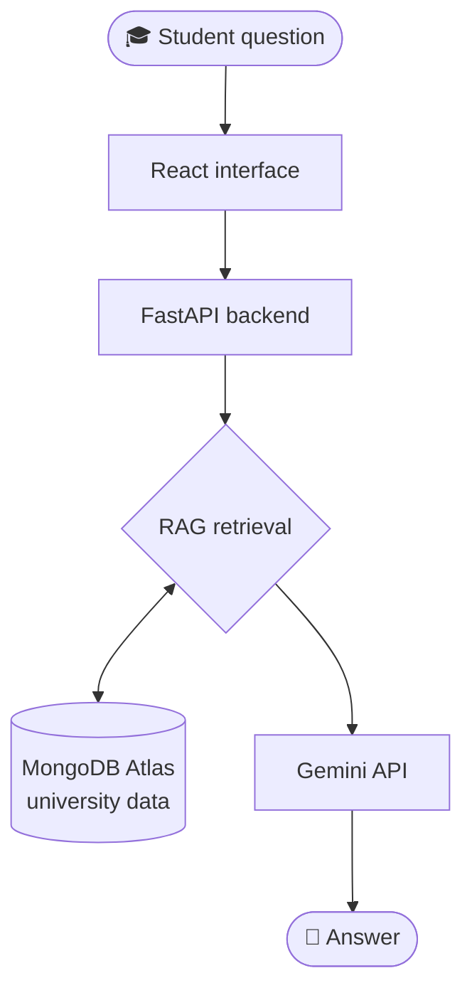

<!-- =====================================================================
     K. Vinay Venkat — GitHub Profile README (ultimate single-file edition)
     Repository name must be exactly: vinay-venkat  (public)
     Upload or paste this whole file as README.md in the repository root.
     No other files or setup needed.
     ===================================================================== -->

<!-- ============================ HERO ============================ -->

 

  

  

<h3>✦ Engineering Intelligent Solutions. Building Technology That Matters. ✦</h3>

<a href="#-about-me">About</a> &nbsp;•&nbsp;
<a href="#-exploring">Exploring</a> &nbsp;•&nbsp;
<a href="#-featured-projects">Projects</a> &nbsp;•&nbsp;
<a href="#-tech-stack">Tech Stack</a> &nbsp;•&nbsp;
<a href="#-github-stats">Stats</a> &nbsp;•&nbsp;
<a href="#-contact">Contact</a>

<!-- ============================ ABOUT ============================ -->
## 👋 About Me

Hi, I’m **K. Vinay Venkat**, a Computer Science and Engineering student specializing in **Artificial Intelligence and Machine Learning** at Centurion University of Technology and Management.

I’m passionate about developing intelligent applications, exploring emerging technologies, and transforming innovative ideas into practical software solutions.

My interests include Artificial Intelligence, Machine Learning, Deep Learning, Generative AI, Computer Vision, Retrieval-Augmented Generation (RAG), and Quantum Computing.

I enjoy working across the development lifecycle, from exploring an idea and designing a solution to building APIs, integrating AI capabilities, and creating useful user experiences.

<!-- Animated terminal card -->

<table>
  <tr>
    <td align="center" width="33%">
      <h3>🎓</h3>
      <b>Education</b> 
      B.Tech CSE (AI &amp; ML), CUTM 
      Previously: Diploma in CSE
    </td>
    <td align="center" width="33%">
      <h3>🎯</h3>
      <b>Focus</b> 
      AI/ML and software development 
      Open-source and meaningful projects
    </td>
    <td align="center" width="33%">
      <h3>🔭</h3>
      <b>Exploring</b> 
      LLM applications, RAG, AI agents 
      and quantum computing
    </td>
  </tr>
</table>

📫 **Contact:** [konduruvinayvenkat@gmail.com](mailto:konduruvinayvenkat@gmail.com)

*Learn continuously. Build intelligently. Create meaningful impact.*

### 🧭 How I Like to Build

### 🗺️ My Interest Map

<!-- ============================ CURRENT FOCUS ============================ -->
## 🔭 Exploring

> [!NOTE]
> These are my interests and learning areas, not claims of professional mastery.

<table>
  <tr>
    <td width="50%" valign="top">
      <h3>🧠 Artificial Intelligence</h3>
      Machine learning, deep learning, model experimentation, and practical AI applications.  
      
      
      
    </td>
    <td width="50%" valign="top">
      <h3>✨ Generative AI</h3>
      Large language models, RAG pipelines, document understanding, and intelligent assistants.  
      
      
      
    </td>
  </tr>
  <tr>
    <td width="50%" valign="top">
      <h3>🛠️ Software Engineering</h3>
      Python applications, REST APIs, backend development, frontend integration, and database-backed systems.  
      
      
      
    </td>
    <td width="50%" valign="top">
      <h3>⚛️ Quantum Computing</h3>
      Learning quantum computing concepts and exploring the Qiskit ecosystem.  
      
      
    </td>
  </tr>
</table>

<!-- ============================ FEATURED PROJECTS ============================ -->
## 🚀 Featured Projects

<table>
  <tr>
    <td width="50%" valign="top">
      <h3>🎓 CenturionGPT</h3>
      
An AI-powered university assistant concept for Centurion University of Technology and Management (CUTM), designed to make academic information easier to access through conversational AI, intelligent search, and document understanding.

      
<b>Stack and concepts:</b> 
      
      
      
      
      
      

      

        
<b>Goals and explored capabilities</b>

         
        These are project goals and explored capabilities, not a list of finished features:
        <ul>
          <li>Gemini AI integration</li>
          <li>Retrieval-Augmented Generation (RAG)</li>
          <li>Academic information assistance</li>
          <li>SGPA and CGPA analysis from academic data</li>
          <li>Syllabus exploration</li>
          <li>Notices and timetable information</li>
          <li>Placement updates</li>
          <li>Document understanding (PDF, DOCX, PPT, Excel, images)</li>
          <li>Semantic search</li>
          <li>Voice interaction</li>
          <li>Admin-managed university information</li>
        </ul>
      

      
<a href="https://remix-centuriongpt-381916554782.asia-southeast1.run.app/">🔗 <b>Launch CenturionGPT</b></a>

    </td>
    <td width="50%" valign="top">
      <h3>🗣️ SamvaadSaathi</h3>
      
A regional-language Augmentative and Alternative Communication (AAC) project focused on supporting accessible communication through symbols, vocabulary, and regional-language support.

      
<b>Stack and concepts:</b> 
      
      
      
      

      

        
<b>Project context</b>

         
        <ul>
          <li>AAC symbol-to-language mapping</li>
          <li>Regional-language and core vocabulary</li>
          <li>Communication accessibility</li>
          <li>Caregiver and therapist-oriented support concepts</li>
          <li>Personalization and accessible communication principles</li>
        </ul>
      

      
<a href="https://github.com/samvaadsaathi/SamvaadSaathi">🔗 <b>View SamvaadSaathi Repository</b></a>

    </td>
  </tr>
  <tr>
    <td width="50%" valign="top">
      <h3>🤝 Find-Make-Team</h3>
      
A project concept for helping people discover teammates and form balanced teams for hackathons, student projects, and collaborative work.

      
<b>Idea areas:</b> 
      
      
      

      
<a href="https://find-make-team.ai.studio/">🔗 <b>Explore Find-Make-Team</b></a>

    </td>
    <td width="50%" valign="top">
      <h3>📂 Explore More Projects</h3>
      
Browse my other work, experiments, and repositories on GitHub.

      
<a href="https://github.com/vinay-venkat?tab=repositories">🔗 <b>Browse All Repositories</b></a>

    </td>
  </tr>
</table>

<b>🧩 CenturionGPT: conceptual flow (click to expand)</b>

 

A simplified view of how a question could travel through a RAG-based university assistant like this one:

<!-- ============================ TECH STACK ============================ -->
## 🧰 Tech Stack

<!-- Icons come from skillicons.dev; Hugging Face, Qiskit and Generative AI use shields.io badges. -->

<table>
  <tr>
    <td width="22%"><b>💻 Languages</b></td>
    <td>
      
    </td>
  </tr>
  <tr>
    <td><b>🧠 AI / ML / Data</b></td>
    <td>
       
      
      
      
      
    </td>
  </tr>
  <tr>
    <td><b>⚙️ Backend</b></td>
    <td>
      
      
    </td>
  </tr>
  <tr>
    <td><b>🎨 Frontend</b></td>
    <td>
      
    </td>
  </tr>
  <tr>
    <td><b>🗄️ Databases</b></td>
    <td>
      
    </td>
  </tr>
  <tr>
    <td><b>🧪 Dev Tools</b></td>
    <td>
      
    </td>
  </tr>
</table>

<!-- ============================ GITHUB STATS ============================ -->
## 📊 GitHub Stats

<h4>🏆 GitHub Trophies</h4>

Trophies and stats appear as you earn them. These widgets come from third-party services and may occasionally be unavailable.

<!-- ============================ LEARNING ============================ -->
## 🏅 Experience, Certifications & Learning

<table>
  <tr>
    <td width="50%" valign="top">
      <h3>✅ Completed</h3>
      <b>Deloitte Australia Data Analytics Job Simulation</b> 
      Forage  
      
    </td>
    <td width="50%" valign="top">
      <h3>📚 Ongoing Learning</h3>
      AI/ML project development, Generative AI applications, quantum computing exploration, and practical software development.
    </td>
  </tr>
</table>

<!-- Add verified certificates and achievements here later. -->

<!-- ============================ GOALS ============================ -->
## 🎯 Current Goals

<table>
  <tr>
    <td width="50%" valign="top">
      🤖 Build useful and reliable AI-powered applications  
      📐 Strengthen machine learning and deep learning foundations  
      🧠 Explore LLM applications, RAG systems, and AI agents  
      🚢 Improve software engineering and deployment skills
    </td>
    <td width="50%" valign="top">
      🌍 Contribute to open-source projects  
      ⚛️ Explore quantum computing and emerging technologies  
      🤝 Collaborate with developers and builders
    </td>
  </tr>
</table>

<!-- ============================ CONNECT ============================ -->
## 🌐 Connect With Me

<!-- TODO: please verify this YouTube handle exists before publishing. -->

### 🧑‍💻 Developer Platforms & Community

### 🔗 Explore My Work

<table>
  <tr>
    <td align="center" width="20%"><a href="https://vinay-vortex.netlify.app/">🌐 <b>Visit Portfolio</b></a></td>
    <td align="center" width="20%"><a href="https://remix-centuriongpt-381916554782.asia-southeast1.run.app/">🎓 <b>Launch CenturionGPT</b></a></td>
    <td align="center" width="20%"><a href="https://find-make-team.ai.studio/">🤝 <b>Explore Find-Make-Team</b></a></td>
    <td align="center" width="20%"><a href="https://github.com/samvaadsaathi/SamvaadSaathi">🗣️ <b>View SamvaadSaathi Repository</b></a></td>
    <td align="center" width="20%"><a href="https://github.com/vinay-venkat?tab=repositories">📂 <b>Browse All Repositories</b></a></td>
  </tr>
</table>

<!-- ============================ CONTACT ============================ -->
## 📬 Contact

 

I’m always interested in connecting with people who enjoy learning, building, and solving meaningful problems with technology. Feel free to reach out for project discussions, collaboration, or professional opportunities.

 

<!-- ============================ FOOTER ============================ -->

**Thanks for visiting my GitHub profile!**

Explore my repositories, share feedback, and let’s build something meaningful together.

